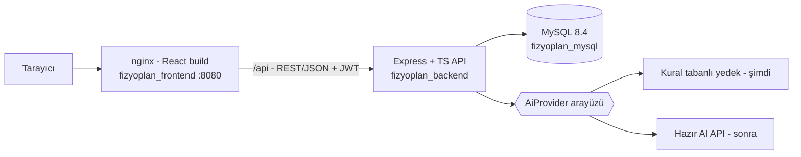
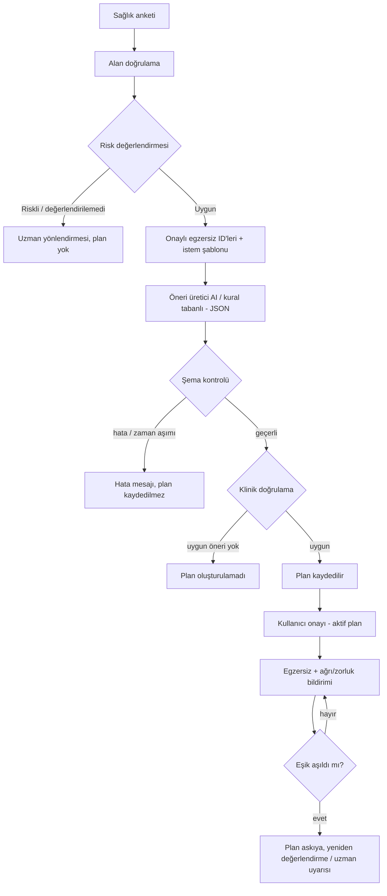

# Tasarım Planı – Fizyoterapi Egzersiz Planlama Sistemi

> Sistem mimarisi, API taslağı ve frontend (React + TypeScript) UI/UX tasarımı. Yol haritası için `Proje Plani.md`.

## 1. Sistem Mimarisi


> Docker Compose projesi `fizyoplan`: üç container aynı `fizyoplan_net` ağında. Geliştirmede yalnızca MySQL Docker'da, backend/frontend `npm run dev` ile çalışır.

## 2. Plan Üretim ve Güvenlik Akışı (PDF Şekil 1)

Klinik uygunluk (Denklem 1): egzersiz onaylı kütüphanede **ve** kontrendikasyon ∩ kullanıcı sağlık durumu = ∅ **ve** set/tekrar/süre sınırlar içinde. Askıya alma (Denklem 2): `ağrı ≥ θa` veya `zorluk ≥ θz`.

## 3. API Uç Taslağı (`/api`)
> Güncel ve ayrıntılı sürüm: **`backend/API.md`** (yanıt şekilleri, hata kodları, ekran eşleşmeleri).

| Method | Uç | Açıklama | Auth |
|---|---|---|---|
| GET | `/health` | Sunucu sağlık kontrolü | – |
| POST | `/auth/register`, `/auth/login` | Kayıt / giriş (JWT) | – |
| GET | `/auth/me` | Oturumdaki kullanıcı | user |
| GET/PUT | `/profile` | Sağlık profili / anket | user |
| GET | `/regions` | Vücut bölgeleri | – |
| GET | `/exercises?region=&difficulty=` | Onaylı egzersizler | user |
| GET | `/exercises/:id` | Egzersiz + video | user |
| POST | `/plans/generate` | Plan üret (risk → öner → filtre) | user |
| GET | `/plans`, `/plans/:id` | Planlarım (günlük/haftalık) | user |
| POST | `/plans/:id/activate` | Kullanıcı onayı | user |
| POST | `/plan-items/:id/feedback` | Ağrı/zorluk bildirimi (askıya alma tetikler) | user |
| POST/PUT | `/admin/exercises` | Egzersiz ekle/onayla | admin/physio |

Hata formatı: `{ "error": { "code": "VALIDATION_ERROR", "message": "…", "details": [...] } }`

## 4. Frontend Tasarımı (React + TypeScript)
**Teknoloji:** Vite + React + TS, React Router, TanStack Query (API), React Hook Form + zod (anket formu), Bootstrap/Tailwind (PDF: responsive, Bootstrap).

### Sayfalar
1. **Giriş / Kayıt**
2. **Sağlık Anketi** (çok adımlı): kişisel bilgi (yaş, boy, kilo) → aktivite düzeyi → ağrı bölgesi seçimi (vücut şeması: bel, boyun, omuz, diz) ve şiddet → kırmızı bayrak soruları
3. **Uzman Yönlendirme Ekranı** (riskli sonuç; plan yok, açık uyarı metni)
4. **Planlarım**: haftalık görünüm (7 gün kartları) + günlük detay
5. **Egzersiz Detay**: video, adım adım metin, set/tekrar/süre, "Tamamladım" + ağrı/zorluk geri bildirimi
6. **Plan Askıya Alındı** ekranı (yeniden değerlendirme / uzmana yönlendirme)
7. **Profil / Ayarlar**: bilgi güncelleme, yazı boyutu, yüksek kontrast
8. (Sonra) **Uzman paneli**: egzersiz onay/ekleme

### Önerilen klasör yapısı
```
frontend/src/
├─ api/            # axios/fetch istemcisi, tipli uç fonksiyonları
├─ components/     # Button, Card, Stepper, BodyMap, PainSlider, VideoPlayer, ...
├─ features/       # auth, survey, plans, exercises, feedback
├─ pages/
├─ hooks/  context/  routes/
├─ types/          # backend DTO'larıyla uyumlu tipler
└─ styles/
```

### UX ve Erişilebilirlik (PDF hedef 5)
- Dinamik yazı boyutu (A-/A+) ve yüksek kontrast modu; WCAG AA kontrast.
- Klavye ile gezinme, ARIA etiketleri, form hata mesajları ekran okuyucuya uygun.
- Mobil öncelikli responsive tasarım; büyük dokunma hedefleri (≥44px).
- Her ekranda görünür uyarı: "Bu uygulama tanı koymaz, muayenenin yerini almaz."
- Ağrı bildirimi: 0–10 kaydırıcı + yüz ikonları; yüksek ağrıda anında uyarı.
- Boş/yükleniyor/hata durumları her sayfada tanımlanır.

### Görsel stil (taslak)
Sakin, güven veren sağlık teması: açık zemin, tek vurgu rengi (teal/mavi), yumuşak köşeler, bol boşluk, sade kartlar. Renk/yazı tipi tokenları `styles/` altında tek yerde tanımlanır (açık/koyu/yüksek kontrast).

## 5. Güvenlik Tasarımı
- Parola: bcrypt; oturum: kısa ömürlü JWT; rate limit + helmet + CORS kısıtı.
- Sağlık verisi: yalnızca sahibi ve yetkili rol görür; loglara sağlık verisi yazılmaz.
- İhlal şüphesinde servis durdurma, oturum anahtarı ve parola sıfırlama (PDF risk tablosu).
- AI'a minimum veri gönderilir (kimlik bilgisi yok; yaş aralığı, bölge, onaylı egzersiz ID'leri).
